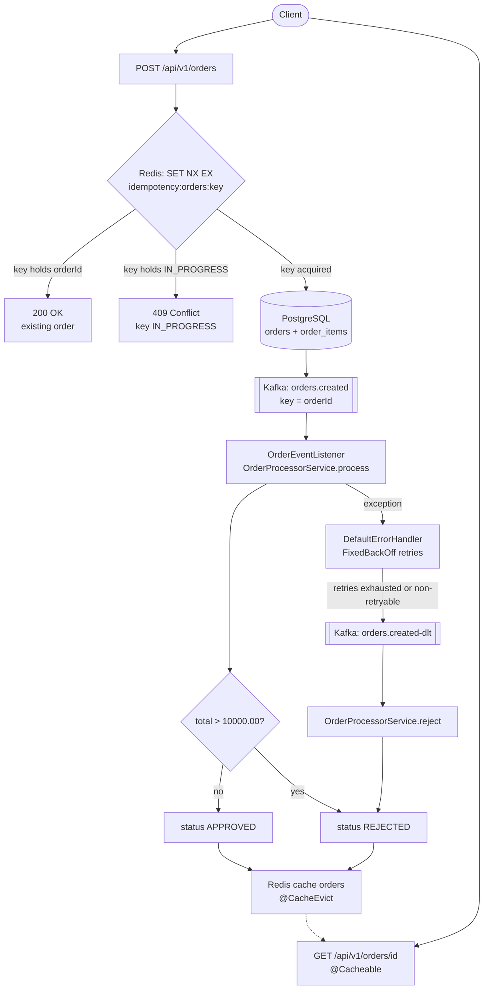

# Order Flow Engine

Order ingestion service with idempotent writes and asynchronous, event-driven processing. Clients submit orders through a REST API protected by an `Idempotency-Key` header. Each order is persisted in PostgreSQL and published to Kafka, where a consumer approves or rejects it. Reads are served from a Redis cache that is invalidated whenever the consumer changes an order's status.

## Architecture and Processing Flow



1. `POST /api/v1/orders` acquires `idempotency:orders:<Idempotency-Key>` in Redis (24h TTL).
2. The order is saved as `PENDING`, the key is updated with the order id, and an `OrderCreatedEvent` is published to `orders.created`.
3. The consumer moves the order to `PROCESSING`, then to `APPROVED`, or to `REJECTED` when the total exceeds 10000.00.
4. If processing fails, the record is retried and then sent to `orders.created-dlt`, where the order is rejected.
5. Every status transition evicts the order from the `orders` cache, so the next `GET /api/v1/orders/{id}` reads the current state from PostgreSQL and caches it again.

## Tech Stack

| Component | Version |
|---|---|
| Java | 21 (virtual threads enabled) |
| Spring Boot | 4.2.0 (Web MVC, Data JPA, Data Redis, Cache, Kafka, Validation, Actuator) |
| PostgreSQL | 17 (`postgres:17-alpine`), schema managed by Flyway |
| Redis | 7 (`redis:7-alpine`) |
| Apache Kafka | 3.9.0 (`apache/kafka:3.9.0`), single node in KRaft mode |
| Tests | JUnit, Testcontainers 2.x, Awaitility, Mockito |

## Key Engineering Decisions

### Idempotent API

`IdempotencyService` uses a single Redis `SET key value NX EX` as the lock. The value starts as `IN_PROGRESS` and is overwritten with the persisted `orderId` once the order is saved.

- First request: the key is acquired and the order is created, returning `201 Created` with a `Location` header.
- Replay with a completed key: no new order is created. The response is `200 OK` with the current state of the existing order, which may differ from the original response if the consumer has already processed it.
- Concurrent request while the first is in flight (`IN_PROGRESS`): `409 Conflict`.
- Any `RuntimeException` during persistence or publishing deletes the key, so the client can retry with the same `Idempotency-Key`.

### Async Messaging, Retry and DLT

- Events are published with `orderId` as the record key, so all events of an order land on the same partition (`orders.created` has 3 partitions).
- The consumer error handler is a `DefaultErrorHandler` with `FixedBackOff` (`app.kafka.retry.interval-ms`, `app.kafka.retry.max-attempts`; 1000 ms and 2 retries by default).
- `IllegalArgumentException` is registered as non-retryable and goes straight to the DLT, since repeating a deterministic failure does not help. Other exceptions are treated as transient and retried first.
- Records that exhaust their retries are published to `orders.created-dlt` by `DeadLetterPublishingRecoverer`. A dedicated listener (`order-flow-dlt` group) calls `OrderProcessorService.reject`, so the order does not stay in `PENDING` indefinitely. Orders already `APPROVED` or `REJECTED` are left untouched.
- `process` is idempotent: it ignores orders that are no longer `PENDING`, which makes redelivery safe.

### Read-Through Cache and Eviction

- `OrderService.findById` is annotated with `@Cacheable("orders")`. Values are `OrderResponse` records stored as JSON (`JacksonJsonRedisSerializer`) with `String` keys, so no JDK serialization is involved.
- TTL is configured by `app.cache.orders-ttl` (10 minutes) and null values are not cached.
- `OrderProcessorService.process` and `reject` are annotated with `@CacheEvict`, so a status change made by the Kafka consumer removes the stale `PENDING` entry.
- Eviction is not coordinated with the transaction commit. A read that races with the commit can cache the old state until the TTL expires or the next eviction.

### Domain Model and Persistence

- `Order` is the aggregate root and owns its `OrderItem`s. The state machine (`PENDING`, `PROCESSING`, `APPROVED`, `REJECTED`) is enforced inside the entity, and items can only be added to a `PENDING` order. The item collection is exposed as unmodifiable.
- `@Version` provides optimistic locking.
- `spring.jpa.open-in-view` is `false`. `OrderRepository.findByIdWithItems` uses an explicit `left join fetch` to load the items in a single query, which avoids both N+1 selects and `LazyInitializationException`.
- Schema changes go through Flyway (`db/migration`), and Hibernate runs with `ddl-auto: validate`.
- Errors are returned as RFC 9457 `ProblemDetail` (`application/problem+json`) by `ApiExceptionHandler`: 400 for validation errors and missing header, 404 for unknown orders, 409 for idempotency conflicts.

### Known Limitations

- The event is published after the database commit, without an outbox. If the broker is unavailable, the order stays `PENDING`.
- The idempotency key is not bound to the request body. Reusing a key with a different payload returns the original order.
- The 10000.00 auto-approval limit is a constant in `OrderProcessorService`.

## Getting Started

### Running the Test Suite

Docker must be running. No `docker compose up` is needed: Testcontainers starts PostgreSQL, Redis and Kafka on random ports and wires them into the Spring context through `@ServiceConnection`. The containers are shared across the whole suite.

```bash
./mvnw clean test
```

### Running Locally

`compose.yaml` defines the three dependencies and exposes the following host ports:

| Service | Host port | Notes |
|---|---|---|
| PostgreSQL | 5434 | database, user `orderflow`, password `secret` |
| Redis | 6379 | |
| Kafka | 9092 | |

The project includes `spring-boot-docker-compose`, so `spring-boot:run` starts the compose services if they are not running and configures the connections automatically. Starting them beforehand is optional:

```bash
docker compose up -d
./mvnw spring-boot:run
```

The API listens on `http://localhost:8080`. Services started by Spring Boot are stopped when the application shuts down gracefully; otherwise use `docker compose down`.

## API Usage Examples

Create an order. The `Idempotency-Key` header is required.

```bash
curl -i -X POST http://localhost:8080/api/v1/orders \
  -H "Content-Type: application/json" \
  -H "Idempotency-Key: 3f2b8c1e-7a4d-4e61-9b0a-5c1d2e3f4a5b" \
  -d '{
    "customerId": "b7e6a1c2-4f3d-4a9e-8c55-1d2f3a4b5c6d",
    "items": [
      { "productId": "0c9d8e7f-6a5b-4c3d-9e2f-1a0b9c8d7e6f", "quantity": 2, "unitPrice": 149.90 },
      { "productId": "5a4b3c2d-1e0f-4a9b-8c7d-6e5f4a3b2c1d", "quantity": 1, "unitPrice": 35.00 }
    ]
  }'
```

```http
HTTP/1.1 201
Location: http://localhost:8080/api/v1/orders/88aa8779-f164-4d90-8083-c7db768fdedb
Content-Type: application/json

{
  "id": "88aa8779-f164-4d90-8083-c7db768fdedb",
  "customerId": "b7e6a1c2-4f3d-4a9e-8c55-1d2f3a4b5c6d",
  "status": "PENDING",
  "totalAmount": 334.80,
  "items": [
    {
      "id": "4f3c8dc7-ab1f-4cd1-94ef-340931d750a5",
      "productId": "0c9d8e7f-6a5b-4c3d-9e2f-1a0b9c8d7e6f",
      "quantity": 2,
      "unitPrice": 149.90,
      "subtotal": 299.80
    },
    {
      "id": "5a2302bd-6aca-4319-b36f-a40de0d9a6d4",
      "productId": "5a4b3c2d-1e0f-4a9b-8c7d-6e5f4a3b2c1d",
      "quantity": 1,
      "unitPrice": 35.00,
      "subtotal": 35.00
    }
  ],
  "createdAt": "2026-11-23T17:10:52.749490Z",
  "updatedAt": "2026-11-23T17:10:52.749514Z"
}
```

Repeat the same request with the same `Idempotency-Key`. No new order is created and the response is `200 OK` with the existing order, including its current status (here already `APPROVED` by the consumer).

```bash
curl -i -X POST http://localhost:8080/api/v1/orders \
  -H "Content-Type: application/json" \
  -H "Idempotency-Key: 3f2b8c1e-7a4d-4e61-9b0a-5c1d2e3f4a5b" \
  -d '{
    "customerId": "b7e6a1c2-4f3d-4a9e-8c55-1d2f3a4b5c6d",
    "items": [
      { "productId": "0c9d8e7f-6a5b-4c3d-9e2f-1a0b9c8d7e6f", "quantity": 2, "unitPrice": 149.90 },
      { "productId": "5a4b3c2d-1e0f-4a9b-8c7d-6e5f4a3b2c1d", "quantity": 1, "unitPrice": 35.00 }
    ]
  }'
```

```http
HTTP/1.1 200
Content-Type: application/json

{ "id": "88aa8779-f164-4d90-8083-c7db768fdedb", "status": "APPROVED", "totalAmount": 334.80, ... }
```

Fetch the processed order. The first read goes to PostgreSQL and populates the cache; later reads are served from Redis until the TTL expires or the order changes status.

```bash
curl -i http://localhost:8080/api/v1/orders/88aa8779-f164-4d90-8083-c7db768fdedb
```

Errors use `ProblemDetail`:

```bash
curl -i http://localhost:8080/api/v1/orders/00000000-0000-0000-0000-000000000000
```

```http
HTTP/1.1 404
Content-Type: application/problem+json

{"detail":"Order not found: 00000000-0000-0000-0000-000000000000","status":404,"title":"Not Found"}
```

An order whose total exceeds 10000.00 ends as `REJECTED` after processing.
